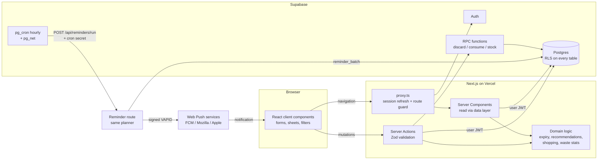

# Savora

Savora is a household food management app. It keeps track of the food in your fridge, freezer and pantry and **schedules your meals for the week so everything is cooked before its date** (the rescue plan). A push notification every morning says what reaches its date and what to cook, even when the site is closed. Adding food takes one sentence: say or type "milk 2 l, eggs 10, spinach" and Savora fills in the rest. A shopping list knows what you already have, and a waste log makes patterns visible.

Built for the NOTAR Academy hackathon (theme: food waste at home).

- **Live app:** https://savora-mauve.vercel.app
- **Presentation (Russian, animated):** https://savora-mauve.vercel.app/pitch (arrow keys, swipe, `F` for fullscreen)
- **Presentation PDF:** [`submission/SAVORA-presentation.pdf`](submission/SAVORA-presentation.pdf) (Russian) · [`submission/SAVORA-presentation-en.pdf`](submission/SAVORA-presentation-en.pdf) (English)
- **Try it:** open the app and press **Explore the live demo**. It signs you in to a private, temporary kitchen filled with sample data. No email is needed.

## Features

| Area | What it does |
| --- | --- |
| Dashboard | Counts of items in stock, items to use soon and items past date; a seven-day expiry timeline; top meal suggestions; food-saving notes generated from your own data; a storage breakdown. |
| Inventory | Each row carries a photo of the food (CC0 photos, see `public/foods/CREDITS.txt`). Add, edit, delete, search, filter (category, storage, status) and sort (date, name, category, recently added). Filters live in the URL and run in the database. |
| **Rescue plan** | Plans meals for the next 7 days (1–3 meals a day) so items are cooked in the order they run out: a scheduling problem with deadlines, solved earliest-deadline-first. Shows how many items reach their date this week, how many the plan uses in time and the value kept out of the bin; explains every meal ("Last chance for baby spinach"); gives a freeze / eat / add-to-soup step for anything no meal fits; missing ingredients go to the shopping list in one tap. |
| **Morning reminders** | Real web push notifications (Android, desktop, iPhone from the Home Screen). Every hour the database itself (`pg_cron` + `pg_net`) wakes the app, which sends each person whose chosen hour has come, in their own time zone, what reaches its date by tomorrow and today's rescue meal. "Send a test reminder now" proves delivery on the spot; every reminder sent is logged and shown on the plan page. |
| **Quick add: voice or one line** | Say or type a whole shop in English or Russian ("молоко 2 л, яйца 10, шпинат и полкило фарша", "two litres of milk, a dozen eggs") and Savora splits it into products with quantity, unit, category, storage and a typical date; unknown foods are flagged to check. "Your usuals" adds the household's most-bought foods in one tap. Saved in one atomic insert. Single-item entry with catalog autofill and quick date buttons is still there. |
| Expiry tracking | Three states: **Fresh**, **Use soon** (date within 3 days) and **Past date**. A dedicated Use soon page groups urgent items and suggests recipes that use them. |
| Meal suggestions | A rule-based engine ranks 24 curated recipes by how urgently their ingredients need using and how much you already have. Each suggestion lists matched and missing ingredients and explains why it was chosen. "I cooked this" updates the inventory; missing ingredients go to the shopping list in one tap. |
| Shopping list | Blocks duplicate entries (in the app and with a unique database index), warns when an item is already at home, groups items by category, and moves bought items into the inventory with a suggested date you can adjust. |
| Waste log | "Throw away" on any product records the quantity, reason, date and a pro-rated cost (only if a price was entered). Separate entries can be logged for untracked food. Statistics: items logged, logged value, this month versus last month, a weekly trend chart, categories and reasons. |
| Predictive Kitchen | Learns from the household's own history, with no external AI: how often each food is bought, how much and how long it lasts, how much of it is thrown away. It flags items likely to go unused (shown as a badge on the product), suggests a smaller amount for foods that are often overbought (one tap updates the shopping list, and the add form shows the hint), and explains every number. With fewer than two purchases of a food it says there is not enough data instead of guessing. |
| Savi companion | A food-creature that lives in the interface (sidebar on desktop, on top of the bottom navigation on phones). On the first visit it gives a guided tour: it walks to each section, the page opens with the part it talks about highlighted, and a large guide card explains it (Next / Skip, shown once). It reacts to real events (adding, using, rescuing, cooking, putting shopping away), speaks in short dismissible bubbles linked to real screens, follows the cursor with its gaze, walks, runs, rolls and jumps around its area, runs over to inspect a product you just added or the first item that needs using, hides and peeks out, celebrates and falls asleep when you're idle. It earns XP and grows through 7 stages; three daily "food rescue" missions add bonus XP. Lively / Quiet / Hidden setting; honours reduced motion. |
| Russian and English | An **RU / EN** switch on the landing page, the sign-in pages and the app sidebar (or the phone account menu). Everything is translated: screens, recipes, Savi's lines and tour, plan reasons, toasts and errors, dates. The choice is kept in a cookie and on the profile, so the morning push arrives in the same language; first visits follow the browser language. Names people type in one language show in the other (a product saved as «Молоко» reads "Milk" in English), and search finds a food in either language. English text is the dictionary key (`src/lib/i18n`), with patterns for generated sentences and Russian plural forms. |
| Demo | One-click anonymous demo account seeded with sample data. Every sample row is stored with `is_demo = true`, tagged **Sample** in the UI and removable in one click. |

Savora makes no food-safety claims. "Past date" means the date someone entered has passed; it is a prompt to check the food, not a verdict.

## Tech stack

- **Next.js 16** (App Router, Server Components, Server Actions, `proxy.ts`), **React 19**, **TypeScript** in strict mode
- **Tailwind CSS 4** with a custom token set, **Lucide** icons, **Recharts** for the waste trend, **GSAP** for Savi's movement, landing transitions and presentation slide transitions (disabled under `prefers-reduced-motion`)
- **Supabase**: PostgreSQL, Auth (email/password and anonymous demo sessions), Row Level Security
- **Zod 4** for validation on every Server Action
- **Vitest** for domain logic, **Playwright** for the end-to-end smoke test

## Architecture



The code is split into layers so that business rules stay testable and independent of React and Supabase:

```
src/
  app/                 routes (landing, auth, /app/*)
  components/          UI, grouped by feature (inventory, meals, shopping, waste,
                       predict, savi, pitch, ui)
  lib/
    domain/            pure TypeScript: dates, expiry, catalog, recipes,
                       recommend, plan (rescue planner), quick-add
                       (speech/text parser), shopping, waste, insights,
                       predict, savi, demo data (+ tests)
    data/              server-only reads (session/viewer, queries)
    actions/           Server Actions: validate → authorise → write → revalidate
    supabase/          clients, proxy session handling, generated DB types
    validation.ts      Zod schemas shared by forms and actions
supabase/migrations/   SQL schema, RLS policies and RPC functions
scripts/e2e-smoke.mjs  Playwright end-to-end test
```

### Data model

| Table | Purpose | Notes |
| --- | --- | --- |
| `households` | A shared food space | Created automatically for every new user by a trigger on `auth.users`. |
| `household_members` | Links users to households | Composite primary key; ready for shared households. |
| `profiles` | Display name, active household, onboarding state | Users may update only `display_name` and `onboarded_at` (column-level grants). |
| `products` | Inventory | `expires_on date` (date-only), `quantity numeric(10,2)`, `price_cents integer`, enums for unit, category and storage, check constraints, indexes on `(household_id, expires_on)` and `(household_id, category)`. |
| `shopping_items` | Shopping list | Generated `name_key` column plus a partial unique index on open items to prevent duplicates. |
| `waste_records` | Discarded food | Reason enum, date, optional cost; indexed by `(household_id, discarded_on)`. |
| `inventory_events` | Purchase / use / waste history for Predictive Kitchen | Append-only, read-only for clients. Written by triggers on `products` and `waste_records` and by `consume_product`; each row carries a normalised `item_key` and, for used food, how many days it was held. |
| `savi_events`, `savi_missions` | Savi XP ledger and daily missions | Append-only, written only by database functions. |
| `push_subscriptions` | Browser push endpoints per user | Owner can read and delete; inserted only through `save_push_subscription` (an endpoint can move between accounts). |
| `reminder_log` | Every reminder sent (daily or test) | Proof of delivery shown in the app; a partial unique index allows one daily digest per user per local day. |

### Security

- Row Level Security is enabled on every table. Policies allow access only to rows whose `household_id` belongs to the signed-in user (`my_household_ids()`, a `SECURITY DEFINER` helper with a fixed `search_path`).
- The anonymous Postgres role has no privileges on household tables.
- The app uses only the Supabase **publishable** key. No service-role key exists in the codebase or in the deployment; every user query runs as the signed-in user, so the database enforces authorisation.
- The only server secrets are the push signing key (VAPID) and the reminder cron secret. The cross-user reminder functions (`reminder_batch`, `reminder_record`, `reminder_prune`) are `SECURITY DEFINER` and refuse to run unless given the cron secret, which the database compares with the copy in Supabase Vault.
- Multi-step writes run as Postgres functions in one transaction and lock the row they change. `discard_product` is `SECURITY INVOKER`, so it passes through RLS. `consume_product`, `cook_recipe` and `stock_purchased_items` must also write the read-only ledgers, so they are `SECURITY DEFINER` with a fixed `search_path` and check household membership explicitly before touching any row.
- Every Server Action validates its input with Zod, checks the session, and returns user-safe error messages. Database error details are logged on the server, not shown to users.
- Redirects after sign-in accept only relative `/app` paths.

### Savi: XP that can't be faked

XP lives in `savi_events`, an append-only ledger that clients can read but never write. Points are recorded by the database itself: a trigger on `products` (adding a real product, +2) and the `consume_product`, `cook_recipe` and `stock_purchased_items` functions (use before the date +3, rescue within 3 days +15, cook +20, put shopping away +10). Each kind has a daily cap, missions complete inside the same transaction, and sample data earns nothing. The award function itself is not executable by the `authenticated` role, so calling it directly fails with `permission denied`. Savi's reactions come from a deterministic rules module (`lib/domain/savi.ts`) with per-message cooldowns and one bubble at a time; there is no LLM involved.

The character art is cut from the team's Savi concept board (background removed with rembg); the two top stages, Food Mage and the sacred Food Guardian with floating food, were generated from that art with an image model (ElevenLabs, GPT Image 2.5) and cut out with BiRefNet. The companion uses the same stage illustration as the Savi page and animates it as one piece (`components/savi/savi-puppet.tsx`): a step bounce and sway tied to walking speed, a squash before a jump and on landing, a stretch in the air. The animation loop stops as soon as Savi is still. Savi's seven stages follow real XP thresholds (0, 60, 160, 320, 560, 900, 1400).

### How Predictive Kitchen works

Every purchase, use and discard is logged to `inventory_events` by the database. `lib/domain/predict.ts` turns that history into per-food patterns (pure functions, unit-tested):

- **Pattern:** number of purchases, average amount, average days between purchases, average days held before use, share of the amount thrown away. Needs at least 2 purchases.
- **Waste risk:** an item in stock is flagged *high* when the household usually needs more days to finish that food than the item has left, or when 40% or more of it has been thrown away before and the date is within 3 days; *medium* when 20% or more went unused and the date is within 5 days. Items already past date are left to expiry tracking. The reason is shown in words.
- **Smart quantity:** after 3 or more purchases with a waste share of 20% or more, Savora suggests the usual amount minus the share that was thrown away, rounded to a sensible step (for example 100 g, 0.5 L or whole pieces).

The demo seeds clearly labelled sample history (`is_demo = true`) so the page has something to show; "Clear sample data" removes it.

### Dates and time zones

Expiry and purchase dates are calendar dates, stored as Postgres `date`. All date arithmetic works on whole UTC days in `lib/domain/dates.ts`. The browser's IANA time zone is stored in a cookie, and the server uses it to work out the viewer's local "today", so a product dated 8 November shows "1 day left" in Tashkent and in Los Angeles at the right moment for each. Tests cover month, year and daylight-saving boundaries.

### How the rescue plan works

`lib/domain/plan.ts`, pure and unit-tested:

1. Every item in date whose date falls in the next 7 days is **at risk**; its date is a deadline.
2. For each day and each meal slot, every recipe is scored by the at-risk items it would use that are still uncovered and still in date on that day. An item's weight grows as its slack (days left minus the meal's day) shrinks: 10 on its last day, 7, 5, 3, then 2. Each missing main ingredient costs 3 points (at most one missing); a dish is not repeated within three days.
3. The best recipe takes the slot and its items are marked as rescued (one dish uses up the at-risk item it includes). This is earliest-deadline-first scheduling, so the tightest items are always planned first.
4. Whatever no meal fits gets a practical step: freeze (meat, fish, bread), eat as is (fruit, dairy) or add to a soup or stir-fry.
5. The page shows the result as numbers: at risk this week, used in time, value kept (only from entered prices) and items needing another rescue. The same planner writes the morning reminder.

### How reminders work

1. The browser registers `public/sw.js` and subscribes with the app's VAPID public key; the subscription is stored with `save_push_subscription`.
2. A `pg_cron` job runs every hour and calls `POST /api/reminders/run` through `pg_net`, sending the cron secret from Vault.
3. The route calls `reminder_batch`, which returns only people whose reminder hour has come in their own time zone and who have not had today's digest, with their products.
4. The route plans each week with the same planner, sends the push with `web-push`, removes subscriptions the push service reports as gone (404/410) and records the result in `reminder_log`.
5. "Send a test reminder now" runs the same path for the signed-in user immediately.

### How meal suggestions work

1. Each inventory item is matched to a catalog ingredient by name ("Cherry tomatoes" → tomato, "Chicken stock" → stock). Longer aliases win, and on a tie the last word wins, because grocery names end with the main noun.
2. Items past their date are ignored.
3. For each recipe, every ingredient is matched to the most urgent product that fits (recipes can list alternatives, such as carrot, pepper or broccoli).
4. Score = urgency of matched items (4 points for ≤1 day, 3 for ≤3 days, 1.5 for ≤7 days, 0.5 otherwise) + 6 × share of main ingredients in stock − 2 per missing main ingredient.
5. Recipes need at least one main ingredient in stock and at most two missing. Pantry staples (oil, salt, pepper, water) are assumed.
6. The explanation is built from the same data: "Uses up baby spinach (1 day left) and feta (2 days left) · You have every main ingredient".

## Running locally

Requirements: Node.js 20 or newer and a Supabase project.

```bash
npm install
cp .env.example .env.local   # then fill in the two values below
npm run dev                  # http://localhost:3000
```

### Environment variables

| Variable | Where to find it |
| --- | --- |
| `NEXT_PUBLIC_SUPABASE_URL` | Supabase → Project Settings → API → Project URL |
| `NEXT_PUBLIC_SUPABASE_PUBLISHABLE_KEY` | Supabase → Project Settings → API Keys → publishable key (`sb_publishable_…`) |
| `NEXT_PUBLIC_VAPID_PUBLIC_KEY`, `VAPID_PRIVATE_KEY` | Generate once with `npx web-push generate-vapid-keys` (reminders only) |
| `CRON_SECRET` | A long random string; store the same value in Supabase Vault as `reminder_cron_secret` (reminders only) |

The Supabase values are public by design. Do not add a service-role key; the app does not need one.

### Database setup

1. Open the Supabase SQL editor (or use the Supabase CLI) and run the files in [`supabase/migrations/`](supabase/migrations) in order. For reminders, first run `select vault.create_secret('<CRON_SECRET>', 'reminder_cron_secret');`; the last migration enables `pg_cron` and `pg_net` and schedules the hourly job (edit its URL for your deployment).
2. In **Authentication → Sign In / Providers**:
   - enable **Allow anonymous sign-ins** (powers the one-click demo);
   - to let people sign up without an email round-trip, turn off **Confirm email**. With confirmation on, Supabase sends a confirmation email and the sign-up form tells the user to check their inbox.
3. In **Authentication → URL Configuration**, set the Site URL to your deployed address.
4. Optional: regenerate types after schema changes with `npx supabase gen types typescript --project-id <ref> > src/lib/supabase/database.types.ts`.

### Scripts

| Command | What it runs |
| --- | --- |
| `npm run dev` | Development server |
| `npm run build` / `npm start` | Production build and server |
| `npm test` | Vitest unit tests for the domain layer |
| `npm run typecheck` | Route type generation and `tsc --noEmit` |
| `npm run lint` | ESLint |
| `npm run presentation` | Prints `/pitch` (needs a running server at `BASE_URL`) and the English HTML deck to PDF |
| `npm run e2e` | Playwright smoke test against `BASE_URL` (default `http://localhost:3000`); set `SHOTS=./shots` to save screenshots |

## Testing

- **Unit tests (Vitest):** 98 tests covering date-only arithmetic and time zones, expiry states and labels, catalog matching in English and Russian, the rescue planner (earliest deadline first, never after a date or with past-date items, no repeats, missing ingredients, two meals a day, rescue steps, reminder text), the speech/text quick-add parser, recommendation ranking and explanations, duplicate detection, waste statistics, product validation, Predictive Kitchen patterns, risks and smart quantities, Savi stages, XP and reactions, and the translation layer (patterns, plurals, coverage of every recipe and Savi line).
- **End-to-end (Playwright):** `scripts/e2e-smoke.mjs` runs the main flows against a live instance: demo sign-in, inventory filtering and search, Savi (rescue XP recorded by the database, missions, settings), Predictive Kitchen (waste risk, smart quantity applied to the shopping list, the add-form hint, the product badge), adding a product with catalog autofill, editing, partial discard into the waste log, deleting, the use-soon view, meal suggestions, adding missing ingredients, the shopping list (duplicate blocking, buying, putting away), logging waste, persistence after reload, a horizontal-overflow check at 1024 px and 390 px, and sign-out. It fails on any browser console error.

## Deployment (Vercel)

1. Import the GitHub repository in Vercel (framework preset: Next.js).
2. Add the two environment variables above for Production and Preview.
3. Set the function region close to the Supabase project (this project uses `sin1`, next to Supabase's `ap-southeast-1`), because each page makes a few database round trips.
4. Deploy, then set the Supabase Site URL to the production domain.

## Design

The logo is a high-contrast serif wordmark in forest green whose "O" is an illustrated orange slice with a sprout; the slice on its own is the app icon. The visual identity uses warm paper tones (`#f5f1e8`), deep forest green (`#1e3a2b`) and saffron accents, with Fraunces for headings, Instrument Sans for interface text and JetBrains Mono for dates and labels. Status colours (fresh, use soon, past date) always come with a text label, and all text colour pairs meet WCAG AA contrast. Dialogs use the native `<dialog>` element, so focus trapping and Escape work everywhere; they open as bottom sheets on phones and side panels on larger screens.

The landing-page photograph (ElevenLabs, Seedream 5 Pro) and the logo (ElevenLabs, GPT Image 2) were generated with image models for this project. The Savi illustrations in the presentation come from the team's character sheets. All other visuals are built in code.

### The presentation

`/pitch` is a 16-slide Russian presentation with animated transitions: problem, the scale of household food waste (sourced figures), audience, solution, features, what makes Savora different (rescue plan, morning reminders, one-sentence entry), live screens, the meal engine, two slides on Savi (who Savi is, and how it grows through seven stages), architecture, value, honesty and the close. Keyboard, swipe, fullscreen and deep links work; under `prefers-reduced-motion` transitions are instant. `npm run presentation` prints it to PDF.

## Limitations

- One household per account. The schema supports shared households, but there is no invite flow yet.
- Push on iPhone works only after adding Savora to the Home Screen (an iOS rule for web apps). Voice input needs a browser with the Web Speech API (Chrome, Edge, Safari); typing works everywhere.
- Prices use a single display currency (USD).
- The recipe collection is a curated set of 24 dishes; suggestions are rule-based and run without an external AI service.
